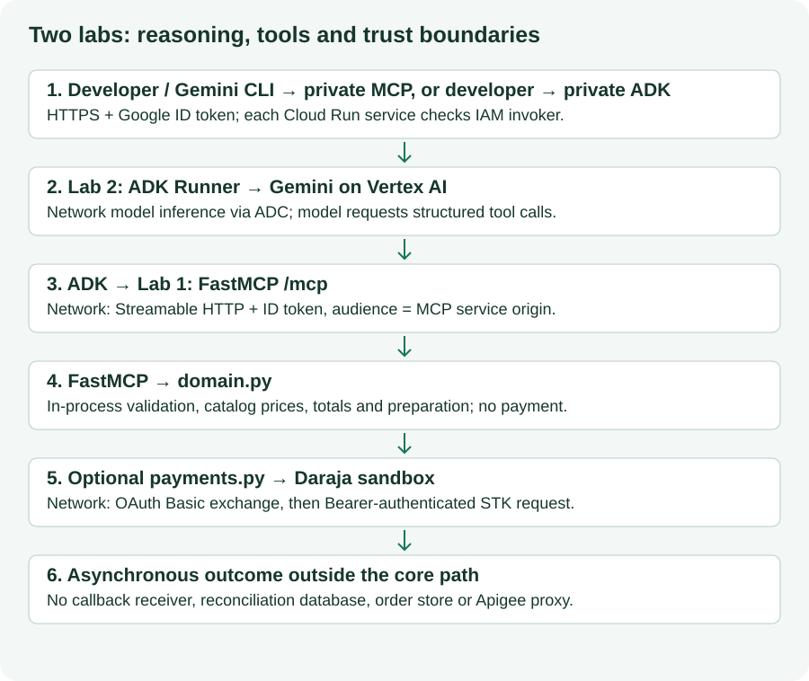
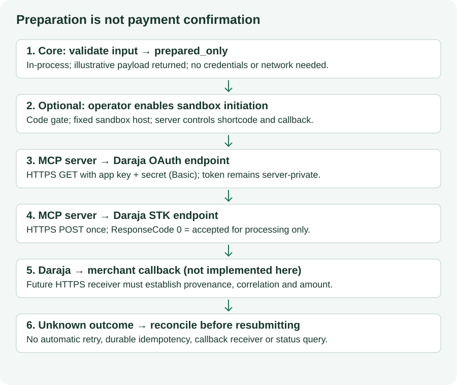
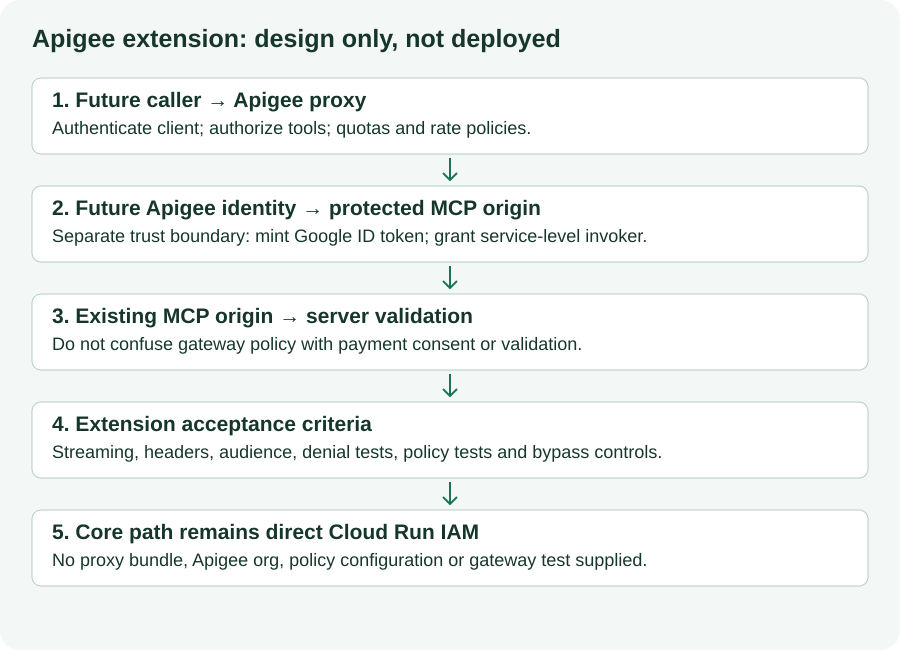

author: Ngesa Marvin

summary: Build merchant tools, prepare payment requests and protect a remote MCP endpoint.

id: decode-mpesa-mcp

categories: Python,Google Cloud,MCP

environments: Web

status: Draft

feedback link: https://github.com/ngesa254/labsdotgde/issues

# Build an M-Pesa Daraja MCP Server on Cloud Run

## From catalog to a trustworthy tool boundary
Duration: 0:05:00

A Nairobi merchant asks, “What do two conference passes cost, and can you prepare an M-Pesa request?” A model can interpret the question. Your server must own the prices, validate the input and control whether an external operation is possible.

This is Lab 1 of **From Code to Cash: Building Agentic Payment Systems with M-Pesa, Apigee, and Google Cloud**. You will build a Model Context Protocol (MCP) server with the standalone `fastmcp` distribution, test it locally, and deploy a protected Cloud Run endpoint. Lab 2 adds a Google Agent Development Kit (ADK) agent.

### Outcomes

- Expose a catalog, basket calculation and payment preparation as typed tools.
- Explain the difference between validation, submission and confirmed payment.
- Require Cloud Run IAM authentication and connect a read-only MCP client.
- Identify where Apigee would sit and which controls still belong in code.



[Open this diagram at full size](assets/architecture.svg)

Solid ordered stages describe the implemented core. The Daraja network call is optional and disabled by default. The callback receiver and Apigee proxy are future components, not resources created by this lab.

### Teaching contract

The core path has six tools and performs **no payment API calls**. The optional seventh tool submits once to the sandbox only after an operator enables it. No order is persisted; there is no callback receiver or reconciliation service. Prices (KES 5, 3 and 1) are fictional teaching fixtures, not market prices.

Durations are estimates: about 100 minutes including installation and cloud waits; allow extra time for organization permissions. You can complete the local checkpoints without a cloud project or Daraja credentials.


> aside positive
> Checkpoint: identify the component that can decide whether to send a payment request. It is server-side code, not the model's wording.

## Choose your workspace and get an early result
Duration: 0:10:00

### Start here

Use a terminal with Bash-compatible commands, Python **3.11** and `pip`. Python 3.14 is not the tested participant runtime. Cloud Shell is the recommended environment for cloud steps; a local terminal with Google Cloud CLI also works. Do not alternate between them without copying your files and restoring variables.

This edition is local authoring output until published. Open the supplied `decode-codelabs/` folder in your editor. For Cloud Shell, upload this folder through the editor before continuing. Run the following from that folder (the one containing `labs/` and `scripts/`).

```bash
export WORKSHOP_ROOT="$PWD"
mkdir -p "$WORKSHOP_ROOT/.work"
test ! -e "$WORKSHOP_ROOT/.work/lab1" && cp -R labs/01-mpesa-mcp-server/sample-code "$WORKSHOP_ROOT/.work/lab1"
cd "$WORKSHOP_ROOT/.work/lab1"
python3.11 -m venv .venv
source .venv/bin/activate
python -m pip install -r requirements.lock
python -m unittest -v test_domain
```

Creating the copy is a one-time operation and intentionally refuses an existing path. On a retry, enter the existing `.work/lab1` directory and activate its environment; do not replace your edited files. Installation may take several minutes. All project-local environments are ignored. The lock is the validated dependency resolution; `requirements.txt` lists direct pins.

If you only have the website, [download Lab 1 sample code](../../downloads/lab1.zip), create an empty `decode-codelabs` directory and a `.work` subdirectory, unzip it there, and rename the extracted `sample-code` directory to `lab1`. Set `WORKSHOP_ROOT` to that `decode-codelabs` directory. The archive includes all code and locks required by this lab.

**Expected:** five unit tests pass. These tests use pure functions, disabled initiation and mocked HTTP. No Daraja credentials are needed; no payment API is called.

**Recovery:** `python3.11: command not found` means you need that interpreter installed through your approved environment, or a Cloud Shell environment providing it. A package resolution failure is different from a cloud IAM failure: inspect the package error first. Do not remove the lock or upgrade packages mid-workshop.

**Unlock:** a deterministic result before touching cloud infrastructure.

## Trace catalog prices and reject invalid baskets
Duration: 0:08:00

### Inspect the execution boundary

Stay in `.work/lab1` with its environment active. Open `domain.py` and inspect `PRODUCTS`, `BasketItem`, `get_product` and `calculate_order_total`. Product IDs and fixture prices match the original workshop: `conf-pass-001` → KES 5, `tee-001` → KES 3, `coffee-001` → KES 1.

```bash
python - <<'CHECK'
from domain import calculate_order_total
print(calculate_order_total([{"product_id": "conf-pass-001", "quantity": 2}]))
print(calculate_order_total([{"product_id": "coffee-001", "quantity": 0}]))
CHECK
```

**Expected:** the first result has `order_total_kes: 10` and `currency: KES`. The second has `error: invalid_basket_item`. This is calculation, not an order or reservation.

The server rejects empty baskets, unknown products, extra item fields, non-integer quantities, booleans, zero and negative quantities. The teaching limits are 20 lines and 100 units per line; they are workshop constraints, not Safaricom limits. Prices come from the catalog, never from a client-provided amount in a basket.

**Checkpoint:** change quantity to `"2"` (a string). It must be rejected rather than silently coerced. Run `python -m unittest -v test_domain` after edits. These read-only checks are safe to repeat.

**Recovery:** if the total differs, compare `domain.py` to the supplied sample before changing the expected test value. The source originally coerced quantities using `int(...)`, accepting values that should have been rejected.

## Prepare an M-Pesa request without sending it
Duration: 0:10:00

### Predict, then inspect

Will a valid request mean money moved? No: the preparation tool is a pure function and has no HTTP client.

```bash
python - <<'CHECK'
from domain import validate_stk_push_payload, parse_stk_callback
print(validate_stk_push_payload("254700000000", 10))
print(parse_stk_callback({"Body": {"stkCallback": {
    "ResultCode": 0, "CheckoutRequestID": "fixture-checkout"}}}))
CHECK
```

`254700000000` is an explicitly fictional syntax fixture; never send it to a payment provider. The prepared result contains `status: prepared_only` and `payment_verified: False`. It is an **example payload**, with placeholders for server-derived fields and a deliberately non-routable callback domain. It is not ready for submission.

`PaymentInput` validates 12-digit Kenyan `2541…` / `2547…` syntax, integer KES amounts from 1 to 1000 and account references up to 12 alphanumeric/hyphen characters. These workshop bounds do not prove that a subscriber exists or that an amount meets current provider limits. The optional integration supports `CustomerPayBillOnline`; Buy Goods is outside this sample.

Callback parsing returns `reported_success: True` for the fixture but always `payment_verified: False`. Anyone can paste JSON. A deployed receiver would need trustworthy provenance, correlation with an initiation ID, expected merchant, amount and authoritative reconciliation before a business action.



[Open this diagram at full size](assets/payment-flow.svg)

> aside negative
> Never accept “I paid,” model text, HTTP 200, or Daraja `ResponseCode: 0` as proof of a completed payment. A successful initiation only establishes acceptance for processing.

**Checkpoint:** `domain.py` cannot contact Daraja; `payments.py` is the only external payment integration. Invalid phone letters and boolean amounts fail the tests. This unlocks safe tool discovery.

## Expose the tools over Streamable HTTP
Duration: 0:08:00

### Run locally

Read `server.py`. It registers six functions using `FastMCP` imported from `fastmcp`, not `mcp.server.fastmcp`. The pinned standalone distribution is **2.12.4**; `httpx` is **0.28.1**. MCP SDK **1.14.1** and Pydantic **2.11.9** are explicitly pinned in this edition.

```bash
export ENABLE_SANDBOX_INITIATION=false
export PORT=8080
python server.py
```

Keep this terminal running. In a second terminal, restore the workspace path, enter `.work/lab1`, and activate its `.venv` before running:

```bash
python smoke_client.py
```

**Expected:** six tool names and a basket total of KES 10. A browser GET at `/` is not an MCP test. The transport is Streamable HTTP at **`/mcp`**; `http` is FastMCP's transport alias. The client context opens, initializes and closes its MCP session. The server uses stateless HTTP to avoid relying on instance-local session routing in Cloud Run.

The service binds `0.0.0.0` and reads Cloud Run's `PORT`. Local mode does not implement IAM; keep this development listener within your trusted environment. Stop it with Ctrl-C after the check. If 8080 is occupied, choose another port and set `MCP_ENDPOINT=http://127.0.0.1:YOUR_PORT/mcp` in the client terminal. Do not terminate another process.

**Checkpoint:** discovery lists `validate_stk_push_payload` but not `initiate_stk_push` or a token-generation tool. Credentials are not model-visible capabilities.

**Recovery:** connection refused → server/port; 404 → `/mcp` path; schema error → input shape. This isolates transport issues before IAM is introduced.

## Select a project and prepare the identities
Duration: 0:12:00

### Switch to the cloud path

From here, commands create or change cloud resources **when you choose to run them**. They were not run while authoring this edition. Use a project approved for training, with billing enabled. Review current pricing and your budget; no fixed cost or free-trial eligibility is promised. Use your organization account when policy requires it.

In Cloud Shell, or a local Google Cloud CLI terminal containing your workshop files:

```bash
export PROJECT_ID="PROJECT_ID"
export REGION="europe-west1"
export MCP_SERVICE_NAME="decode-mpesa-mcp"
export AGENT_SERVICE_NAME="decode-payment-agent"
export MCP_RUNTIME_SERVICE_ACCOUNT="decode-mcp@${PROJECT_ID}.iam.gserviceaccount.com"
export RUNTIME_SERVICE_ACCOUNT="decode-agent@${PROJECT_ID}.iam.gserviceaccount.com"
gcloud auth list
gcloud config set project "$PROJECT_ID"
gcloud services enable run.googleapis.com artifactregistry.googleapis.com cloudbuild.googleapis.com iam.googleapis.com --project="$PROJECT_ID"
```

Replace `PROJECT_ID` with the actual project ID, not its display name. `europe-west1` preserves the source region as a teaching default; choose an approved supported region before creating resources. Model availability is checked separately in Lab 2.

An authorized administrator must arrange these permissions. Do not compensate for a missing role by switching to a default runtime identity.

| Identity | Required responsibility |
|---|---|
| Administrator | Enable APIs, create dedicated service accounts, manage IAM and billing under organization policy |
| Human deployer | `roles/run.sourceDeveloper`, `roles/serviceusage.serviceUsageConsumer` on project; `roles/iam.serviceAccountUser` on runtime identity |
| Build identity | `roles/run.builder` on project for Cloud Run source build; distinct from the runtime |
| MCP runtime | No project-level role needed for core catalog/preparation |
| Agent runtime (Lab 2) | Service-level MCP invoker and Vertex AI access |

Create the two dedicated runtime accounts once:

```bash
gcloud iam service-accounts create decode-mcp --display-name="DECODE MCP runtime" --project="$PROJECT_ID"
gcloud iam service-accounts create decode-agent --display-name="DECODE agent runtime" --project="$PROJECT_ID"
```

`ALREADY_EXISTS` is a cue to inspect ownership, not delete an account. Current source deployment can use the Compute default service account as build identity; existing projects may differ. Have the administrator confirm the build identity and grant `roles/run.builder` to that identity. Keep it separate from `decode-mcp` and `decode-agent`. See [Cloud Run source deployment](https://cloud.google.com/run/docs/deploying-source-code) for current IAM prerequisites.

**Checkpoint:** `gcloud iam service-accounts describe "$MCP_RUNTIME_SERVICE_ACCOUNT" --project="$PROJECT_ID"` identifies the dedicated runtime. API enablement and IAM propagation can take several minutes. Permission denied belongs with the administrator; do not broaden runtime permissions.

## Build and deploy a protected MCP service
Duration: 0:12:00

### Deploy from the prepared source

Starting state: local tests passed, administrator prerequisites complete, project/region/runtime variables restored. In the terminal containing the files:

```bash
cd "$WORKSHOP_ROOT/.work/lab1"
gcloud run deploy "$MCP_SERVICE_NAME" --project="$PROJECT_ID" --region="$REGION" \
  --source=. --service-account="$MCP_RUNTIME_SERVICE_ACCOUNT" \
  --no-allow-unauthenticated --set-env-vars=ENABLE_SANDBOX_INITIATION=false \
  --min-instances=0 --max-instances=2 --timeout=180
export MCP_SERVICE_URL=$(gcloud run services describe "$MCP_SERVICE_NAME" \
  --project="$PROJECT_ID" --region="$REGION" --format='value(status.url)')
printf '%s\n' "$MCP_SERVICE_URL"
```

This creates a service or replaces its revision. Do not reuse a service name owned by another exercise. The Dockerfile uses `python:3.11.14-slim`, installs the resolved lock, runs without root, and starts `server.py`. Container base tags are versioned but not digest-locked; see the validation limitations. Google source build uses the Dockerfile, so Docker is not required on your laptop.

**Long operation:** source build and provisioning may take 5–10 minutes or longer. On the first source deployment, Cloud Run may create the regional `cloud-run-source-deploy` Artifact Registry repository. It can be shared by other services; record what this lab actually created.

**Expected:** deployment reports a revision and URL. This text is an expected result, not evidence of a deployment performed during authoring. Always discover the actual URL; do not construct it from project number or service name.

```bash
curl -s -o /dev/null -w '%{http_code}\n' "$MCP_SERVICE_URL/mcp"
```

An unauthenticated call should be rejected (typically 403; authentication failures can also surface as 401). A 200 is a failed security checkpoint: inspect the service's IAM policy and invoker authentication setting before continuing. `--no-allow-unauthenticated` is not a substitute for reviewing a pre-existing service's configuration.

**Recovery:** build error → dependency/build logs; startup error → container logs and `PORT`; `actAs` denied → deployer's service-account permission. Keep the dedicated runtime identity.

## Authenticate a client and connect Gemini CLI
Duration: 0:10:00

### Verify IAM separately from the model

The administrator grants your signed-in account invoker permission on this MCP service only:

```bash
export CALLER_ACCOUNT=$(gcloud config get-value account)
gcloud run services add-iam-policy-binding "$MCP_SERVICE_NAME" --project="$PROJECT_ID" \
  --region="$REGION" --member="user:${CALLER_ACCOUNT}" --role=roles/run.invoker
export ID_TOKEN=$(gcloud auth print-identity-token)
export MCP_ENDPOINT="${MCP_SERVICE_URL}/mcp"
python smoke_client.py
```

Use the lab1 Python environment. Do not echo the token. `gcloud auth print-identity-token` is the documented human development token path. Runtime service-to-service tokens in Lab 2 require an audience equal to the receiving **service origin**, without `/mcp`. These are Google ID tokens, not Daraja OAuth tokens and not Google API access tokens.

**Expected:** six tools and KES 10 from the remote service. If that fails, solve it before adding Gemini. Tokens are short-lived (commonly about one hour); refresh before reconnecting. This smoke client does not refresh an open connection automatically.

### Optional Gemini CLI demonstration

Use an already installed, authenticated Gemini CLI; run `gemini --version` and record it in your own test notes. Its installation and model sign-in are separate prerequisites, not authoring dependencies. The current [official MCP configuration reference](https://geminicli.com/docs/tools/mcp-server/) supports `httpUrl`, `headers` and environment substitution.

In an empty demonstration directory under `.work/lab1`, create `.gemini/settings.json` using an editor:

```json
{
  "mcpServers": {
    "decode-merchant": {
      "httpUrl": "${MCP_ENDPOINT}",
      "headers": {"Authorization": "Bearer ${ID_TOKEN}"}
    }
  }
}
```

For example, `mkdir -p "$WORKSHOP_ROOT/.work/lab1/demo/.gemini"`, save the file there, then `cd "$WORKSHOP_ROOT/.work/lab1/demo"`. This avoids overwriting your personal settings. The JSON contains literal variable references, not a token. Export `MCP_ENDPOINT` and `ID_TOKEN` in the same terminal before launching `gemini`. Use `/mcp` to inspect discovery, then ask:

```text
List the catalog. Calculate the total for two conf-pass-001 items. Do not initiate payment.
```

Inspect the tool calls and their results, not only the model's prose. Leave normal tool approval enabled. Exit with `/quit`. After token expiry, quit, regenerate `ID_TOKEN` and restart the CLI so it reads the new environment. This explicit refresh replaces the original instruction to overwrite global settings with a baked token.

**Recovery:** 401/403 → identity, invoker binding or expiry; wrong endpoint → service origin plus `/mcp`; model login failure → Gemini CLI authentication. The CLI's chosen model is separate from Lab 2's Vertex model.

## Understand the optional sandbox integration
Duration: 0:10:00

### Read before enabling anything

The core is complete without Daraja credentials. Inspect `payments.py`: it contains an optional real network integration with a fixed sandbox base URL. The operator must set `ENABLE_SANDBOX_INITIATION=true` at process startup to register the initiation tool; a prompt cannot enable it. Lab 2's allowlist excludes it even if the server registers it.

| Variable | Source and sensitivity |
|---|---|
| `DARAJA_CONSUMER_KEY` / `DARAJA_CONSUMER_SECRET` | Your sandbox app in the Daraja portal; sensitive credentials |
| `DARAJA_BUSINESS_SHORTCODE` | Your portal's M-Pesa Express sandbox setup; server configuration |
| `DARAJA_PASSKEY` | Portal-provided passkey; sensitive; never a tool argument |
| `DARAJA_CALLBACK_URL` | Merchant-controlled HTTPS receiver; its authenticity and data handling must be reviewed |
| `ENABLE_SANDBOX_INITIATION` | Operator gate; false for this workshop's core deployment |

The example `.env.example` contains placeholders; it is **not loaded automatically** by `server.py`. Do not copy real credentials into source or command history. For a later authorized cloud extension, an administrator can provide pre-created, versioned Secret Manager references using Cloud Run `--set-secrets`, granting secret-level `roles/secretmanager.secretAccessor` only to the MCP runtime. Secret creation and integration are outside this core path; [Cloud Run secrets documentation](https://cloud.google.com/run/docs/configuring/services/secrets) explains the workflow.

The optional implementation performs OAuth Basic exchange at `/oauth/v1/generate?grant_type=client_credentials`, keeps the bearer token private, computes Base64(`shortcode + passkey + UTC timestamp`) immediately before a single STK POST to `/mpesa/stkpush/v1/processrequest`, and returns only acceptance and request IDs. Production uses a different provider base URL (`https://api.safaricom.co.ke`) and onboarding; this code deliberately has no production-host switch.

It does not return credentials, passwords or full request bodies to the model. It does not automatically retry. A timeout after submission returns `outcome_unknown`; a resubmission can duplicate the transaction. There is no durable idempotency ledger or order/amount binding in this standalone initiation function. The small amount cap is not proof of customer consent. Human confirmation in a chat is not a server-enforced authorization record.

**Local checkpoint:** the mocked acceptance and timeout cases in `test_domain.py` verify the shape and no-retry behavior without contacting Daraja. Provider portal details require sign-in and were not fully retrievable during authoring. Before any later sandbox demonstration, verify current endpoint fields, test subscriber rules, shortcode/passkey and callback behavior in [Daraja's M-Pesa Express page](https://developer.safaricom.co.ke/apis/MpesaExpressSimulate). Do not promise that a sandbox prompt reaches a handset, deducts no money, or reverses production payments automatically.

> aside negative
> This edition supplies no callback receiver, status-query tool or durable reconciliation. Do not enable real initiation as an unattended agent capability. No actual payment request is needed to finish either lab.

## Place Apigee and diagnose failures
Duration: 0:07:00

### Apigee is an extension, not an installed gateway

The original workshop describes an Apigee-ready edge but supplies no proxy bundle or policies. This edition preserves that design discussion without drawing Apigee as deployed.



[Open this diagram at full size](assets/apigee.svg)

A later proxy would authenticate callers, authorize capabilities, enforce quotas and forward Streamable HTTP correctly. Its own Google identity would need service-level invoker on the MCP origin and an ID token for that origin. Gateway authentication does not replace server validation or customer payment authorization. Restrict direct access to the origin if the intended policy is mandatory gateway use. Read [Apigee Google authentication](https://cloud.google.com/apigee/docs/api-platform/security/google-auth/overview) and [MCP in Apigee](https://cloud.google.com/apigee/docs/api-platform/apigee-mcp/apigee-mcp-overview) before designing that extension.

### Recovery by failing boundary

| Symptom | Inspect first | Recovery |
|---|---|---|
| Install/import error | Active Python and lock | Activate lab1 environment; reinstall its lock |
| Local connection refused | Server terminal and chosen port | Start it; set client endpoint to same port |
| Source build failed | Cloud Build log | Resolve dependencies/build identity; redeploy deliberately |
| Container failed to listen | Cloud Run startup logs | Check `PORT`, files and startup command |
| Remote 401/403 | Caller identity, audience, expiry and IAM | Refresh human token; verify service-level invoker |
| MCP 404 or discovery failure | URL and transport | Use Streamable HTTP at `/mcp` |
| Agent guesses catalog data | Tool trace | Compare tool result; move to Lab 2's tool contract |
| Daraja OAuth failure (extension) | Sandbox app configuration | Operator checks credentials privately |
| STK timeout (extension) | Request correlation | Outcome unknown; reconcile before resubmitting |

```bash
gcloud run services logs read "$MCP_SERVICE_NAME" --project="$PROJECT_ID" --region="$REGION" --limit=20
```

Logs establish request execution, not payment settlement. Do not log headers, subscriber data, passkeys or request payloads. The sample returns sanitized errors; use cloud request/build logs to distinguish network and infrastructure failures. Read-only inspection is safe to repeat.

## Hand off to Lab 2 and clean up at the right time
Duration: 0:05:00

### Keep the MCP service for Lab 2

Carry forward **`PROJECT_ID`, `REGION`, `MCP_SERVICE_NAME`, `MCP_SERVICE_URL`, `AGENT_SERVICE_NAME`, `MCP_RUNTIME_SERVICE_ACCOUNT`, `RUNTIME_SERVICE_ACCOUNT`** and the local `WORKSHOP_ROOT` path. No Daraja credential or temporary ID token is needed by Lab 2. Save only non-secret configuration in `.work/workshop.env` using an editor:

```bash
export PROJECT_ID="PROJECT_ID"
export REGION="europe-west1"
export MCP_SERVICE_NAME="decode-mpesa-mcp"
export AGENT_SERVICE_NAME="decode-payment-agent"
export MCP_SERVICE_URL="https://MCP_SERVICE_HOST.run.app"
export MCP_RUNTIME_SERVICE_ACCOUNT="decode-mcp@PROJECT_ID.iam.gserviceaccount.com"
export RUNTIME_SERVICE_ACCOUNT="decode-agent@PROJECT_ID.iam.gserviceaccount.com"
```

Replace placeholders with your values. In a fresh terminal, set `WORKSHOP_ROOT` to the supplied folder, run `source "$WORKSHOP_ROOT/.work/workshop.env"`, then enter the relevant lab directory and activate its `.venv`. Rediscover the URL with `gcloud run services describe` after a redeployment. Do not save tokens or secrets in this file.

**Completion checkpoint:** local unit tests passed, remote read-only smoke client returned KES 10, and unauthenticated access was denied. If you skipped cloud deployment, record “local only”; Lab 2's cloud path requires the protected endpoint.

[Continue to Lab 2: Build an ADK payment preparation agent](../decode-adk-payment-agent/)

### Only if you are stopping here

These commands delete the named lab service and dedicated runtime; inspect the names and project first. They are instructions, not actions taken during authoring.

```bash
gcloud run services describe "$MCP_SERVICE_NAME" --project="$PROJECT_ID" --region="$REGION" --format='value(status.url)'
gcloud run services delete "$MCP_SERVICE_NAME" --project="$PROJECT_ID" --region="$REGION"
gcloud iam service-accounts delete "$MCP_RUNTIME_SERVICE_ACCOUNT" --project="$PROJECT_ID"
```

Delete `decode-agent` only if this lab created it and Lab 2 will not use it. Keep shared Artifact Registry repositories, projects, APIs and billing intact. Inspect images/build source storage created by your deployments and delete only identified lab artifacts through the console; service deletion does not remove those artifacts. See Lab 2 for final scoped IAM cleanup. Remove local credentials/tokens from your session (`unset ID_TOKEN`) when finished.

[Return to the workshop landing page](../../index.html)
