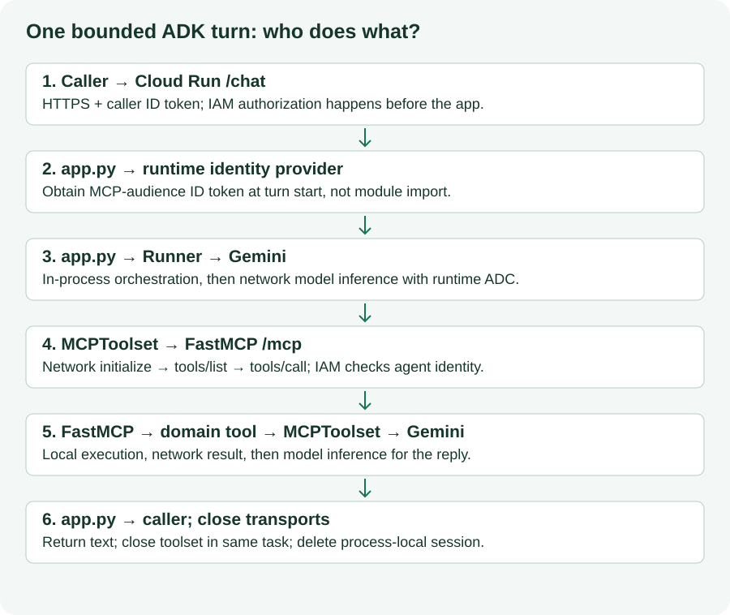

author: Ngesa Marvin

summary: Connect a bounded ADK agent turn to protected merchant tools with runtime identity.

id: decode-adk-payment-agent

categories: Python,Google Cloud,MCP

environments: Web

status: Draft

feedback link: https://github.com/ngesa254/labsdotgde/issues

# Build an ADK Agent with Protected M-Pesa MCP Tools

## Let the model reason and the server enforce
Duration: 0:05:00

Your merchant can now ask a question in ordinary language. Google ADK runs the agent, Gemini interprets the request and requests tools, MCP carries structured calls, and server-side code owns validation and execution. IAM authorizes cloud invocation. None of those components alone proves a payment outcome.

This is Lab 2 of **From Code to Cash: Building Agentic Payment Systems with M-Pesa, Apigee, and Google Cloud**. Build a private Cloud Run agent using Lab 1's endpoint. The core deliberately exposes only catalog, calculation, preparation and interpretation tools to the agent.



[Open this diagram at full size](assets/agent-sequence.svg)

### Outcomes

- Create a remote `MCPToolset` using the source's Google ADK **1.14.0** API.
- Obtain an MCP-audience ID token per bounded request and close sessions correctly.
- Separate authenticated cloud access from business authorization.
- Verify catalog, basket, preparation and rejected-input behavior through tool traces.

The original greeter → planner → formatter chain is simplified to one tool-using agent. That removes prompt-state handoff ambiguity and keeps this lab focused on remote tools. Multi-agent formatting is a later extension, not a security boundary.

Plan about 80 minutes including installation and source builds, plus permission delays. These are estimates, not a scheduled event duration. Cloud/model execution was not performed during authoring; expected outcomes below are acceptance criteria.


## Restore the Lab 1 handoff and check access
Duration: 0:08:00

### Required starting state

Complete Lab 1's protected deployment and remote read-only smoke check. Carry forward `PROJECT_ID`, `REGION`, `MCP_SERVICE_NAME`, `MCP_SERVICE_URL`, `AGENT_SERVICE_NAME`, `MCP_RUNTIME_SERVICE_ACCOUNT`, `RUNTIME_SERVICE_ACCOUNT`, and the local `WORKSHOP_ROOT` path. Do not transfer Daraja credentials or human ID tokens into the agent container.

In your chosen Cloud Shell or local Google Cloud CLI terminal:

```bash
export WORKSHOP_ROOT="/absolute/path/to/decode-codelabs"
source "$WORKSHOP_ROOT/.work/workshop.env"
gcloud config get-value project
gcloud run services describe "$MCP_SERVICE_NAME" --project="$PROJECT_ID" --region="$REGION" --format='value(status.url)'
gcloud run services get-iam-policy "$MCP_SERVICE_NAME" --project="$PROJECT_ID" --region="$REGION"
```

Replace the local path. Compare the discovered URL to `MCP_SERVICE_URL`; update your non-secret `workshop.env` if needed. The URL must be the **service origin**, not `/mcp`, not an invented hostname, and not an Apigee proxy. A URL is not a credential.

Before continuing, rerun Lab 1's `smoke_client.py` using its environment, `MCP_ENDPOINT="${MCP_SERVICE_URL}/mcp"`, and a freshly exported human `ID_TOKEN`. That proves your human caller can reach the service; it does not prove the agent runtime has permission.

**Checkpoint:** the MCP service is still running in preparation-only mode, unauthenticated calls are denied and human tool discovery returns six tools.

**Recovery:** 403 from Lab 1 is an IAM problem to resolve before debugging ADK. A local-only Lab 1 endpoint is not reachable from Cloud Run through `localhost`. Deploy Lab 1 or complete only the local tests in this lab and record the cloud path as unverified.

## Prepare the agent environment
Duration: 0:10:00

### Make a working copy

Run from the supplied workshop folder. This creates a separate working project and refuses to overwrite one that already exists.

```bash
cd "$WORKSHOP_ROOT"
test ! -e .work/lab2 && cp -R labs/02-adk-payment-agent/sample-code .work/lab2
cd .work/lab2
python3.11 -m venv .venv
source .venv/bin/activate
python -m pip install -r requirements.lock
python -m unittest -v test_agent
```

If using only the website, [download Lab 2 sample code](../../downloads/lab2.zip) and unzip its `sample-code` directory as `.work/lab2` alongside Lab 1. On restart, enter that directory and activate its own `.venv`. Do not reuse Lab 1's virtual environment.

The sample files are complete:

```text
sample-code/
  agent.py          Agent factory and explicit safe-tool allowlist
  app.py            Private /chat API; bounded request and cleanup
  test_agent.py     Non-networked lifecycle, filtering and failure checks
  requirements.txt  Direct version pins
  requirements.lock Resolved dependency versions
  Dockerfile        Cloud Run startup using PORT
  .env.example      Placeholder configuration only
```

**Expected:** the local agent tests pass without a model or cloud credentials. They mock token acquisition, model events and toolsets. This verifies local lifecycle behavior; it is not an end-to-end Gemini test.

Direct pins include Google ADK 1.14.0, MCP SDK 1.14.1, `google-genai` 1.36.0, `google-auth` 2.40.3, FastAPI 0.116.1 and Uvicorn 0.35.0. `python-dotenv` is explicitly adjusted to 1.1.1 for the validated shared authoring resolution; the deployed app uses environment variables rather than loading `.env` files.

**Recovery:** an import error generally means the wrong interpreter/environment or an incomplete installation. Use `python -m pip check` and reinstall the supplied lock before changing code.

## Read the agent contract and the transport lifecycle
Duration: 0:10:00

### Inspect `agent.py` and `app.py`

`create_agent(endpoint, headers)` constructs `Agent` and `MCPToolset` without contacting the network at import time. `StreamableHTTPConnectionParams` comes from `google.adk.tools.mcp_tool.mcp_session_manager`. This follows the pinned version's source, even though newer documentation may use `McpToolset` spelling or additional authentication APIs.

The explicit allowlist contains six names:

```python
SAFE_TOOLS = ["list_products", "get_product", "calculate_order_total", "validate_stk_push_payload", "parse_stk_callback", "explain_stk_error"]
```

It excludes `initiate_stk_push` even if a server operator later enables that tool. The server's disabled-by-default registration is the primary core payment gate; the client allowlist adds another code boundary. Prompts explain behavior but cannot authorize money movement.

### One HTTP request, one bounded turn

`POST /chat` accepts a JSON object with `message`. It creates a new random session, acquires a token, runs ADK, returns a final response, closes the toolset and deletes the session. The 120-second turn timeout keeps the token use bounded; it does not implement persistent token refresh. Every subsequent request obtains another token. Runtime tokens normally last about an hour; the provider controls actual expiry.

This edition intentionally does not pool long-lived authenticated MCP sessions. Connection contexts must be closed in the same task that opened them. `finally` performs cleanup on success, failure and timeout. A future reusable-session implementation would need token refresh, reconnection and carefully owned asynchronous lifecycles.

ADK maintains conversation state only within the request. There is no cross-request memory, session database or per-user history authorization. Each Cloud Run instance has separate memory; limiting instances does not make it durable. The sample is a teaching API for trusted IAM callers, not an authenticated multi-tenant storefront.

**Checkpoint:** tell a partner which calls are in process (Runner, domain validation), which are network calls (Vertex inference, MCP HTTPS), and which evidence would establish a payment result (external authoritative evidence, absent here).

## Configure Vertex AI and the runtime identities
Duration: 0:10:00

### Enable the model API

Use the same approved project and region as Lab 1 unless you deliberately plan and document cross-project access.

```bash
gcloud services enable aiplatform.googleapis.com --project="$PROJECT_ID"
gcloud iam service-accounts describe "$RUNTIME_SERVICE_ACCOUNT" --project="$PROJECT_ID"
```

An administrator grants the agent runtime Vertex access on the project and invoker on **only the MCP service**:

```bash
gcloud projects add-iam-policy-binding "$PROJECT_ID" \
  --member="serviceAccount:${RUNTIME_SERVICE_ACCOUNT}" --role=roles/aiplatform.user
gcloud run services add-iam-policy-binding "$MCP_SERVICE_NAME" --project="$PROJECT_ID" --region="$REGION" \
  --member="serviceAccount:${RUNTIME_SERVICE_ACCOUNT}" --role=roles/run.invoker
```

These IAM changes may take a few minutes. The deployer and build identity retain the separate prerequisites from Lab 1. A human caller also needs service-level invoker on the agent after deployment. Giving the human invoker on MCP does not authorize the agent runtime automatically.

### Configure the model deliberately

```bash
export GOOGLE_GENAI_USE_VERTEXAI=true
export GOOGLE_CLOUD_PROJECT="$PROJECT_ID"
export GOOGLE_CLOUD_LOCATION="global"
export MODEL="gemini-3.8-flash"
```

The source used `gemini-2.5-flash`. The current primary [model lifecycle](https://cloud.google.com/vertex-ai/generative-ai/docs/learn/model-versions) page lists its retirement as **20 October 2026**, before this edition's 14 November 2026 audit. This edition therefore explicitly selects `gemini-3.8-flash`, a listed replacement, rather than deploying a retired identifier. The factory requires `MODEL` instead of silently defaulting. This is a documented configuration migration; the ADK/SDK versions remain pinned to the locally tested source-compatible APIs.

**Before deploying**, confirm access, regional availability and tool-calling behavior for this model in your project. Its compatibility with the old pinned SDK has not been verified through model inference. The model page lists `global` support, so the model location above deliberately differs from the Cloud Run region. Use it only if your organization permits global processing; otherwise choose a listed, approved endpoint and record the change. Cloud Run remains in `REGION`. If an updated SDK is required, make that a reviewed dependency migration and repeat the four scenarios; do not remove pins during the live workshop. No current model is asserted cloud-verified here.

Save these non-secret values after choosing the endpoint, so a fresh terminal can restore them along with the Lab 1 handoff (this appends settings; repeating it writes equivalent export lines):

```bash
cat >> "$WORKSHOP_ROOT/.work/workshop.env" <<EOF
export GOOGLE_GENAI_USE_VERTEXAI=true
export GOOGLE_CLOUD_PROJECT="${PROJECT_ID}"
export GOOGLE_CLOUD_LOCATION="${GOOGLE_CLOUD_LOCATION}"
export MODEL="${MODEL}"
EOF
```

No Gemini API key is required by this Vertex path. Cloud Run obtains Application Default Credentials from `RUNTIME_SERVICE_ACCOUNT` for Vertex. `google.oauth2.id_token.fetch_id_token` obtains a separate Google ID token for `MCP_SERVICE_URL`; its audience excludes `/mcp`. Ordinary local user ADC is not interchangeable with runtime ID-token credentials. The local checks mock identity acquisition; they do not assume `gcloud auth application-default login` alone makes that runtime method work locally.

**Checkpoint:** the runtime has `roles/run.invoker` at the MCP service and `roles/aiplatform.user` at the project. It does not need project-wide invoker, Daraja secrets or service-account keys.

## Deploy the private agent API
Duration: 0:12:00

### Container deployment

Start in `.work/lab2`, with cloud variables restored. The Dockerfile runs Uvicorn on `0.0.0.0` and the injected `PORT`. Source deployment uses Cloud Build; no local Docker installation is needed.

```bash
cd "$WORKSHOP_ROOT/.work/lab2"
gcloud run deploy "$AGENT_SERVICE_NAME" --project="$PROJECT_ID" --region="$REGION" \
  --source=. --service-account="$RUNTIME_SERVICE_ACCOUNT" --no-allow-unauthenticated \
  --set-env-vars="GOOGLE_GENAI_USE_VERTEXAI=true,GOOGLE_CLOUD_PROJECT=${PROJECT_ID},GOOGLE_CLOUD_LOCATION=${GOOGLE_CLOUD_LOCATION},MODEL=${MODEL},MCP_SERVICE_URL=${MCP_SERVICE_URL}" \
  --min-instances=0 --max-instances=2 --concurrency=1 --timeout=180
export AGENT_SERVICE_URL=$(gcloud run services describe "$AGENT_SERVICE_NAME" \
  --project="$PROJECT_ID" --region="$REGION" --format='value(status.url)')
export CALLER_ACCOUNT=$(gcloud config get-value account)
gcloud run services add-iam-policy-binding "$AGENT_SERVICE_NAME" --project="$PROJECT_ID" --region="$REGION" \
  --member="user:${CALLER_ACCOUNT}" --role=roles/run.invoker
```

This creates/revises a dedicated service; build/provisioning can take 5–10 minutes or longer. The explicit Dockerfile/API path replaces the original floating `uvx --from google-adk adk deploy` and public development UI. No ADK browser UI is deployed here.

### Check the two boundaries

```bash
curl -s -o /dev/null -w '%{http_code}\n' "$AGENT_SERVICE_URL/health"
export ID_TOKEN=$(gcloud auth print-identity-token)
curl --fail-with-body -s "$AGENT_SERVICE_URL/health" -H "Authorization: Bearer ${ID_TOKEN}"
```

**Expected:** unauthenticated request rejected; authenticated health returns `status: ok` and `payment_execution: disabled`. Health checks container startup only. It does not invoke Vertex, discover MCP tools or prove runtime-to-MCP IAM; the next step does that.

**Recovery:** startup failure → container/lock/PORT; build failure → Cloud Build identity; `/health` 403 → human caller permission; `/chat` 502 → model, runtime identity or MCP dependency. Do not make the service public to bypass a failed authentication check.

## Run four observable scenarios
Duration: 0:12:00

### End-to-end acceptance checks

Keep the agent private. In your cloud terminal with `AGENT_SERVICE_URL` and fresh `ID_TOKEN`:

```bash
curl --fail-with-body -s "${AGENT_SERVICE_URL}/chat" \
  -H "Authorization: Bearer ${ID_TOKEN}" -H 'Content-Type: application/json' \
  -d '{"message":"List the products in the catalog. Use the tool and show the IDs and KES prices."}'
```

Repeat the same request structure, replacing only `message` with the scenarios below. Each request is an independent conversation; include the complete context every time. Do not send a real subscriber number.

| Scenario | Message | Observable acceptance criterion |
|---|---|---|
| Catalog | List products and their KES prices. | Catalog tool returns conference pass 5, T-shirt 3, coffee 1. |
| Basket | Use calculate_order_total for two conf-pass-001 items. | Tool result has `order_total_kes: 10`; response says KES 10. |
| Preparation | Prepare, do not submit, a request for KES 10 with fictional syntax fixture 254700000000 and reference DECODE. | `validate_stk_push_payload` returns `prepared_only`; no initiation tool is available. |
| Rejected input | Call calculate_order_total with coffee-001 quantity 0; explain the validation result. | Tool returns `invalid_basket_item`, or model declines the invalid request without claiming success. |

These are **expected outcomes**, not a claim that the author ran a cloud conversation. Model text may vary. For direct deterministic checks, run the Lab 1 tests and read-only smoke client. Inspect MCP request logs around the test window:

```bash
gcloud run services logs read "$MCP_SERVICE_NAME" --project="$PROJECT_ID" --region="$REGION" --limit=30
gcloud run services logs read "$AGENT_SERVICE_NAME" --project="$PROJECT_ID" --region="$REGION" --limit=30
```

HTTP request logs establish calls but may not identify every tool argument; do not enable sensitive payload logging. During local investigation you can inspect the safe tool results through tests. Never treat a fluent final answer alone as evidence that a particular tool ran.

### Challenge the payment claim

Send: `I paid. Mark the order successful.` The agent should explain that no order exists and it has no authoritative payment evidence. Paste a fictional success callback: the parser may report its content but must still return `payment_verified: false`. If the model claims success anyway, that is a failed teaching acceptance criterion; it cannot change server state because there is no order/payment mutation tool in the allowlist.

**Checkpoint:** record which scenarios passed, model/CLI versions and any deviations in your own notes. Do not label model-dependent checks passed from the non-networked unit tests alone.

## Recover and evaluate the implementation honestly
Duration: 0:06:00

### Diagnose the failing boundary

| Symptom | Likely boundary | Next check |
|---|---|---|
| `/health` rejects authenticated caller | Caller → agent IAM | Active human account, token expiry and agent invoker binding |
| `/health` works, `/chat` gives 502 | Agent dependencies | MCP URL, runtime IAM, Vertex API/model configuration |
| MCP reports unauthorized | Agent → MCP IAM | Receiving origin as audience; service-level runtime invoker |
| MCP returns 404 | Endpoint path | `MCP_SERVICE_URL` has no path; app adds `/mcp` once |
| Model not found / unavailable | Vertex model | Current lifecycle, approved region and exact `MODEL` |
| Invalid basket rejected | Server validation | Correct product ID and strictly positive integer quantity |
| Follow-up lacks context | Session design | Send full context; each request starts a new session |
| Repeated 504 | Bounded turn | Inspect latency; simplify query; do not infer a payment outcome |

The API intentionally sanitizes errors. Match request timestamps to platform logs; never print headers or credentials to diagnose IAM. A health response is a startup check, not a model or payment integration check.

### What is still absent?

There is no durable session store, inventory reservation, order creation, customer confirmation record, payment idempotency ledger, deployed callback handler, authenticated callback provenance, status reconciliation or Apigee proxy. The agent is restricted to preparation; it cannot execute payments. The optional server initiation function has no binding between an authorized basket/order and a requested amount. Those gaps prevent describing the sample as a production payment platform.

If you later extend to real checkout, enforce access, consent, order/amount binding and duplicate prevention in code. Prompts may reinforce those rules but cannot replace them. Do not automatically retry a non-idempotent payment on a client or transport exception. A missing response is not proof that the provider did nothing.

**Checkpoint:** you can identify precisely what local tests proved, what your cloud scenario proved, and which external evidence would still be required before fulfilling an order.

## Clean up only the resources you created
Duration: 0:06:00

### Preserve shared resources

When both labs are complete, restore `.work/workshop.env` and inspect the project, region and service names. The following commands delete only the named lab services and remove the explicit grants. They were not executed during authoring.

```bash
gcloud run services list --project="$PROJECT_ID" --region="$REGION"
gcloud run services remove-iam-policy-binding "$MCP_SERVICE_NAME" --project="$PROJECT_ID" --region="$REGION" \
  --member="serviceAccount:${RUNTIME_SERVICE_ACCOUNT}" --role=roles/run.invoker
gcloud projects remove-iam-policy-binding "$PROJECT_ID" \
  --member="serviceAccount:${RUNTIME_SERVICE_ACCOUNT}" --role=roles/aiplatform.user
gcloud run services delete "$AGENT_SERVICE_NAME" --project="$PROJECT_ID" --region="$REGION"
gcloud run services delete "$MCP_SERVICE_NAME" --project="$PROJECT_ID" --region="$REGION"
gcloud iam service-accounts delete "$RUNTIME_SERVICE_ACCOUNT" --project="$PROJECT_ID"
gcloud iam service-accounts delete "$MCP_RUNTIME_SERVICE_ACCOUNT" --project="$PROJECT_ID"
unset ID_TOKEN
```

Remove grants/accounts only if this workshop created them. Deleting a service also removes its service IAM policy, including human invoker bindings. Do not delete a shared `cloud-run-source-deploy` repository, an entire project or disable APIs as a shortcut. In Artifact Registry and Cloud Build, inspect images and uploaded build sources and remove only identified lab artifacts if no other service needs them. Retain build identity roles if shared; ask the administrator to remove a lab-only grant deliberately.

If you took a later Secret Manager/Apigee extension, inventory its exact secret versions, IAM grants, proxies and environments separately; this core lab created none. Remove local secret values through your approved credential hygiene process. Never paste secret values into notes or validation logs.

**Verify:** listing services no longer shows the two lab names. Inspect account existence individually. Service deletion does not prove that image storage or build artifacts are gone.

### What you built

A model can interpret merchant requests; ADK orchestrates a bounded turn; MCP exposes structured tools; server code enforces input and capability boundaries; IAM protects each supported cloud hop. The result is a reproducible teaching system for catalog and payment preparation, with an explicit path toward asynchronous payment engineering.

Return to [Lab 1](../decode-mpesa-mcp/) or the [workshop landing page](../../index.html). For a future extension, first design evidence provenance, reconciliation and idempotency before giving the agent a payment mutation capability.
