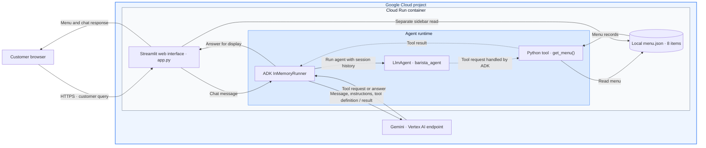

# Deploy a RAG AI Barista with Google ADK, Streamlit, and Cloud Run

**[View the rendered AI Barista architecture guide](https://ngesa254.github.io/labsdotgde/)**

> Google for Developers Day: Nairobi · November 13, 2026 · Sarit Expo Center

Build and deploy a coffee shop assistant that uses a menu tool to ground its recommendations. Start with eight menu items in a JSON file, then optionally add semantic retrieval with Firestore.

## What you will build

- A Streamlit chat interface with a menu sidebar.
- A Google ADK agent that calls a Python menu tool and answers with Gemini.
- A Cloud Run service using a dedicated runtime service account.
- An optional Firestore version that retrieves up to three semantic matches and reflects menu updates without redeploying.

[Open the HTML architecture guide](BARISTA_CLOUD_RUN_ARCHITECTURE.html) · [View editable diagrams](architecture.md).

The sidebar reads the menu separately from the chat tool. Test both paths. Chat state is kept in memory and can reset on refresh or a new connection.

## What you will learn

1. Configure the project, billing, APIs, and workshop resource names.
2. Define a tool and instructions that ground responses in menu data.
3. Build a Streamlit interface around an ADK agent.
4. Deploy Python source to Cloud Run with the appropriate runtime identity.
5. Check availability, dietary preferences, prices, and conversational follow-ups.
6. Optionally seed Firestore embeddings, build a vector index, and test live retrieval.
7. Remove the workshop resources after the session.

## Prerequisites

- A Google account and a Google Cloud project with billing enabled.
- Permission to enable APIs, build and deploy services, create the runtime identity, and assign the roles described in the lab.
- Google Cloud Shell with Bash and Python 3, plus basic familiarity with Python, JSON, and terminal commands.
- For the extension: permission to create a named Firestore database, write menu documents, and create its vector index.

The supplied guide uses project ID `angelic-bee-193823`, whose display name is `labsdotgde`. Participants should use their own authorized project ID. The repository folder and the Google Cloud project are separate resources.

## Lesson navigation

| Step | Lesson | Outcome |
|---|---|---|
| 1 | [What you are building](01_overview.md) | Understand the agent, tool, UI, and retrieval paths |
| 2 | [Project, account, billing, and APIs](02_project_setup.md) | Verify the intended account and project |
| 3 | [Choose a track and create the source folder](03_choose_track.md) | Separate rehearsal and live resources |
| 4 | [Create the mock menu](04_create_menu.md) | Write and validate eight menu records |
| 5 | [Build the agent and Streamlit interface](05_build_agent_and_ui.md) | Create dependencies, agent, UI, and source checks |
| 6 | [Deploy to Cloud Run](06_deploy_cloud_run.md) | Build and deploy the base service |
| 7 | [Verify the base behavior](07_test_barista.md) | Check recommendations, availability, preferences, and prices |
| 8 | [Optional: Firestore vector search](08_firestore_vector_search.md) | Add semantic retrieval and the Matcha update demo |
| 9 | [Cleanup](09_cleanup.md) | Remove resources owned by the selected track |
| 10 | [Troubleshooting and completion checklist](10_troubleshooting.md) | Diagnose errors and record completion |

## How to follow the lab

Run the numbered lessons in order using the same Cloud Shell terminal. The deployment function and exported variables are reused in later steps. If you open a new terminal, restore the project and track variables and redefine the deployment function before continuing.

For preparation, use `TRACK="test"` and finish the base checks. For the live workshop, use `TRACK="lab"` and repeat steps 3–7. Complete the base path before starting the optional Firestore extension. Keep the rehearsal deployment available as a fallback until the live session finishes.

Code is included in the lesson blocks: you will create `menu.json`, `requirements.txt`, `agent.py`, and `app.py` in Cloud Shell. The extension also creates `menu_store.py` and `seed.py` in a separate source folder.

## Completion checks

- [ ] The intended project has billing and the required APIs enabled.
- [ ] The Cloud Run URL loads the menu sidebar and chat interface.
- [ ] The assistant recommends available items and gives listed prices.
- [ ] Unavailable items and dietary preferences are handled using menu facts.
- [ ] A follow-up price question works in the same chat session.
- [ ] If completing the extension, direct vector search and the Matcha update both work.
- [ ] Workshop resources are cleaned up after use.

## Source and validation

These lessons preserve the code, package pins, model identifiers, and rehearsal observations in the supplied `barista-cloud-run-lab.md`. Rehearsal evidence is historical source material. Dependencies, model availability, credits, and deployed behavior still need to be checked in the workshop environment; they were not revalidated as part of organizing these documents.

[Start step 1](01_overview.md) · [Event overview](../README.md) · [Original Google Cloud codelab](https://codelabs.developers.google.com/codelabs/cloud-run/build-streamlit-rag-agent-google-adk-cloud-run)
