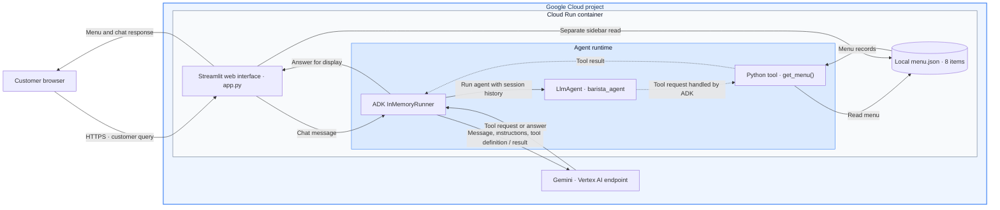
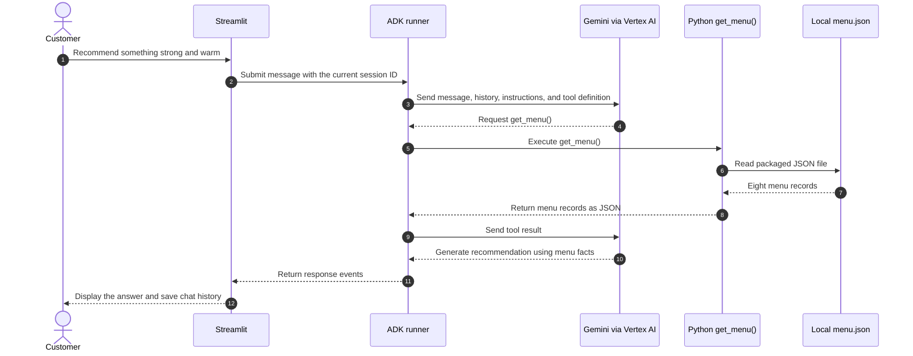
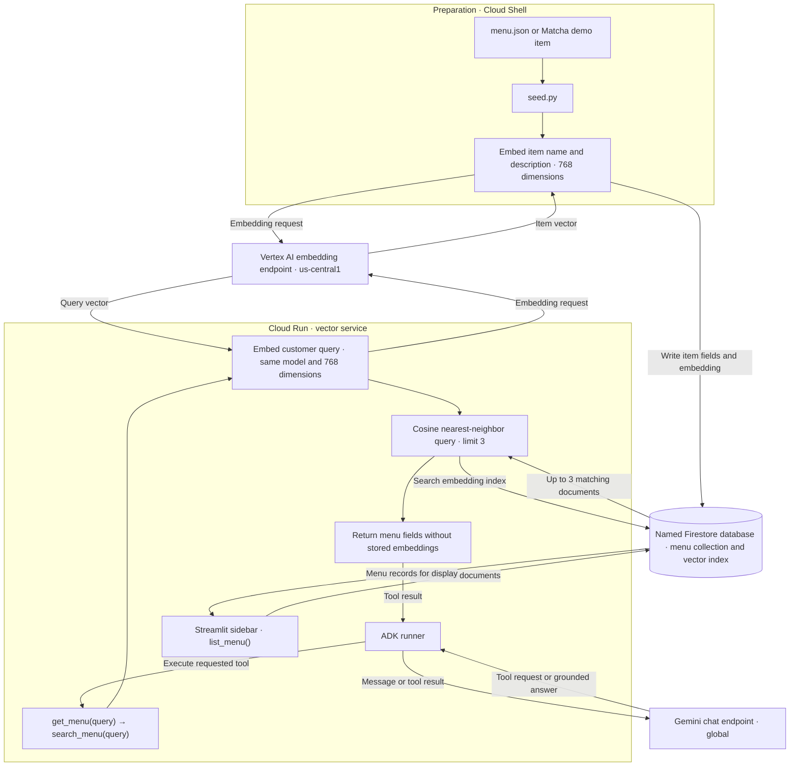
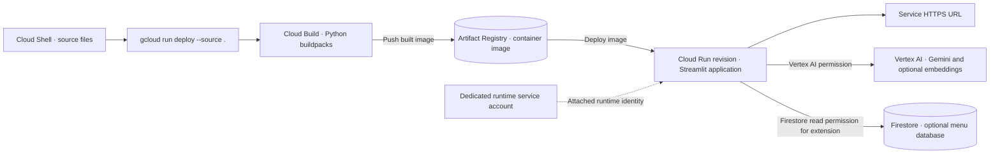

# Barista architecture and request flow

[Open the HTML architecture guide](BARISTA_CLOUD_RUN_ARCHITECTURE.html) for a browser presentation with navigation, expandable diagrams, and print support.

These diagrams follow the supplied architecture and sequence references and the workshop's Python code. The base application runs Streamlit, the ADK runner, the agent definition, and the menu tool in the same Cloud Run container. Gemini inference is an external API call from that container through Vertex AI.

## Base architecture: Gemini and local menu retrieval

`agent.py` defines the agent and menu tool. `app.py` creates the runner, manages the Streamlit session, reads the sidebar menu, and displays responses. ADK executes the Python function when Gemini requests a tool call. The diagram separates these responsibilities; they run inside one Python application.

The runtime service account provides the application's cloud identity. Cloud Build and Artifact Registry support deployment, as shown below.

## Chat sequence: menu question

This sequence illustrates a menu lookup. A greeting can produce a response without a tool call. ADK handles the model/tool loop; the model requests the function and the runner executes it. The sidebar loads menu data independently, so a visible sidebar alone does not verify the chat path.

The base tool reads the entire menu. Embeddings and nearest-neighbor search are introduced in the optional extension.

## Optional Firestore retrieval flow

Seed writes and runtime queries use the same database, embedding model, and vector length. Menu tags, prices, and allergen fields accompany retrieved candidates and support factual checks. Similarity ranks candidates; a top-three result is not an exhaustive availability check.

The Matcha demo writes a new document and embedding to Firestore. Subsequent tool calls can retrieve it without rebuilding the Cloud Run service. Refresh the page to reload the sidebar. See [step 8](08_firestore_vector_search.md) for the seed, index, and verification commands.

## Source deployment flow

The deployer, build identity, and runtime service account have separate responsibilities. [Step 6](06_deploy_cloud_run.md) covers the deployment and runtime role; [step 8](08_firestore_vector_search.md) adds Firestore read access. Deployment creates the URL, while the browser/chat checks in [step 7](07_test_barista.md) confirm application behavior.

[Lab overview](README.md) · [Step 1](01_overview.md) · [Event overview](../README.md)
